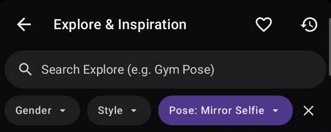
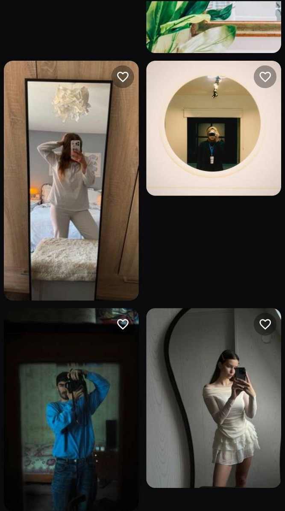
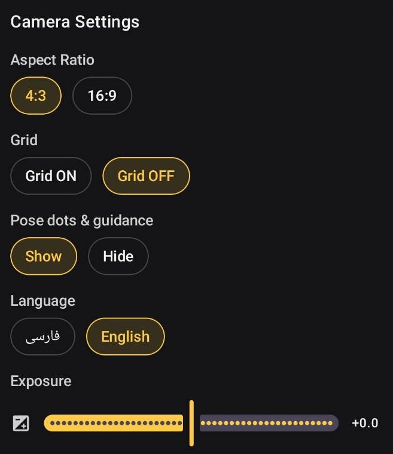
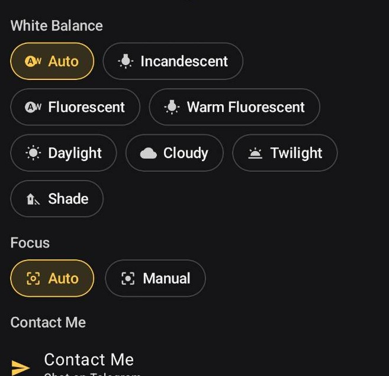
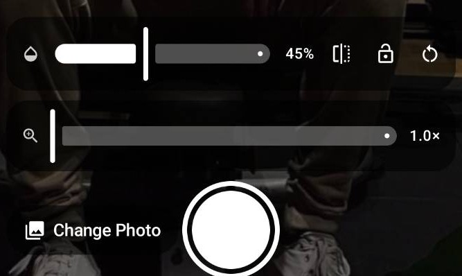

# ChikChik

A mobile photography app focused on helping users compose photos, explore pose inspiration, and adjust camera settings from one place.

> **This README describes the free version using the screens currently available.** It documents only the features visible in the supplied screenshots; platform requirements, account features, pricing boundaries, and any additional capabilities should be added only after they are confirmed.

## Overview

ChikChik brings together three practical parts of the photo-taking process:

- **Explore & Inspiration** — browse photo-pose ideas and narrow them down with search and filters.
- **Camera Settings** — adjust framing, guides, exposure, white balance, and focus preferences.
- **Camera** — compose a shot using the live camera preview and on-screen controls.

The goal of the free version is to make taking a better-planned photo easier, without needing to switch between separate inspiration and camera screens.

## Features in the free version

### 1. Explore & Inspiration

Find ideas before taking a photo.

- Search the inspiration collection by keyword.
- Filter ideas by **Gender** and **Style**.
- Filter by pose type; the supplied screen shows **Mirror Selfie**.
- Browse inspiration cards in a visual grid.
- Use the heart icon on a card to mark an idea as a favorite.
- Access the favorites and recently viewed/history areas from the screen header.

### 2. Camera Settings

Customize the camera experience to suit the scene and the way you prefer to shoot.

**Framing and guidance**
- Choose **4:3** or **16:9** aspect ratio.
- Turn the camera grid on or off.
- Show or hide pose dots and guidance.

**Language**
- Choose between **Persian** and **English** in the settings screen.

**Image controls**
- Adjust exposure compensation.
- Select a white-balance preset:
  - Auto
  - Incandescent
  - Fluorescent
  - Warm Fluorescent
  - Daylight
  - Cloudy
  - Twilight
  - Shade
- Choose **Auto** or **Manual** focus.

### 3. Camera screen

Use the camera preview to frame the subject and adjust the visible shooting controls before capturing a photo.

The supplied camera screen shows:
- A live camera preview.
- On-screen framing guidance.
- Camera options in the top toolbar.
- An exposure/lighting adjustment control.
- A zoom control with a displayed zoom level.
- A **Change Photo** option.
- A dedicated shutter button.

## Screenshots

The screenshots above are cropped from the app screens provided for this README. They are intended to illustrate the visible free-version interface, not to claim features that are not shown.

## Project status

This README is based on the currently supplied UI screenshots. The following details have not yet been confirmed and are intentionally left unspecified:

- Minimum Android version and supported device list
- App version and release channel
- Installation / download link
- Whether favorites and history sync across devices
- Which features, if any, are exclusive to a paid edition
- Privacy policy and data-handling details

## Getting started

When a public build or source repository is available, add the verified installation instructions here. Do not publish placeholder package names, download links, or build commands as if they were real.

## Feedback and contributions

For bug reports, feature requests, or contributions, use the repository's **Issues** and **Pull requests** sections once they are enabled.

## License

No license has been specified yet. Add a license only after the project owner has selected the terms under which the app and its source code may be used.
